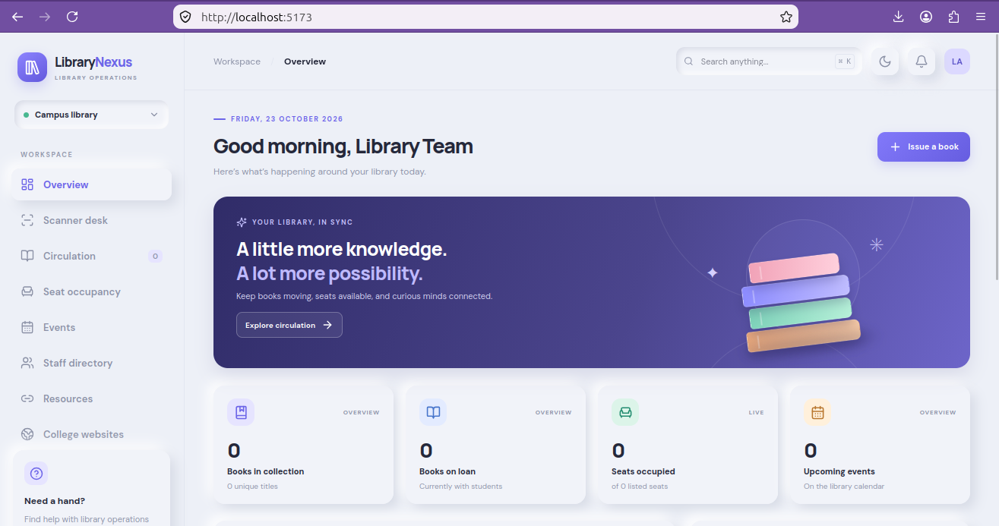

# LibraryNexus — MERN Library Management System

A modern library operations dashboard built with **MongoDB, Express, React, and Node.js**. Includes book circulation tracking, 15-day return reminders by email, seat occupancy, library events, staff directory, important resources, and college website directory.

<p align="center">
  
</p>

<p align="center">
  <em>LibraryNexus — Library management made simpler.</em>
</p>

## Features
- **Circulation:** track which student has which book, issue date, due date, days remaining, and return status.
- **Email reminders:** daily scheduler emails students when a book is due soon or overdue. The default loan period is 15 days.
- **Seats:** occupancy status, student, start/end time, and availability.
- **Events:** upcoming and completed library events.
- **Staff:** head librarian, assistant, and staff directory.
- **Resources & college links:** one place for KIHAs, NPTEL, and configurable college websites.
- **Dashboard:** overview cards, recent circulation, due-soon list, and responsive navigation.
- **Light/dark neumorphic UI:** toggle theme; responsive layout; Lucide icons.

## Stack
- React + Vite
- Express + Node.js
- MongoDB + Mongoose
- Nodemailer + node-cron
- Lucide React icons

## Requirements
- Node.js 20+
- MongoDB local instance or MongoDB Atlas connection
- SMTP account if email reminders are required

## Run locally

### 1. Backend
```bash
cd server
cp .env.example .env
npm install
# Edit .env and set MONGODB_URI. Configure SMTP to send real email.
npm run seed
npm run dev
```
API runs at `http://localhost:5000`.

### 2. Frontend
In a second terminal:
```bash
cd client
npm install
npm run dev
```
Open the Vite URL shown in the terminal (usually `http://localhost:5173`).

## Email reminder configuration
Set these in `server/.env`:
```env
SMTP_HOST=smtp.example.com
SMTP_PORT=587
SMTP_SECURE=false
SMTP_USER=your-account@example.com
SMTP_PASS=your-app-password
MAIL_FROM=LibraryNexus <your-account@example.com>
REMINDER_HOUR=9
```
The scheduler runs daily at the configured hour and emails active loans due within 3 days or already overdue. Loan due dates are set to **15 days after issue** by default. Never commit real credentials. For Gmail, use an app password where applicable, not your normal account password.

## API overview
- `GET/POST /api/books`
- `GET/POST /api/loans`, `PATCH /api/loans/:id/return`
- `GET/POST /api/seats`
- `GET/POST /api/events`
- `GET/POST /api/staff`
- `GET/POST /api/resources`
- `GET/POST /api/websites`
- `GET /api/dashboard`
- `POST /api/reminders/run` (manual reminder trigger; protect this endpoint before production)

## Important production notes
This is a starter project, not a fully hardened institutional deployment. Before real use, add authentication and role-based permissions, audit logs, rate limiting, input validation, backups, HTTPS, CSRF protection where applicable, and restrict reminder-trigger access. Configure institutional privacy policy and email consent/retention practices. The included seed data is fictional demo data. Replace demo resources, staff, emails, and college links with verified official details.

## License
MIT — see [LICENSE](LICENSE).
<<<<<<< HEAD


## QR / barcode scanner desk

The **Scanner desk** uses `@zxing/browser` to scan QR codes and common 1D barcodes from a webcam. It also accepts USB barcode scanners (most behave like a keyboard and type into the manual scan field) and manual code entry.

Workflows included:
- **Issue book:** scan a book barcode/ISBN, then scan the student's library card. The API creates a 15-day loan and decrements availability.
- **Return book:** scan the book code to close an active loan and restore availability.
- **Add book:** scan/enter the new label code, fill in the book details, and save.
- **Seat check-in/out:** scan a registered seat code to toggle occupied/available status.

Seeded demo codes (after a successful `npm run seed`):
- Books: `BK-ATOMIC-001`, `BK-CLEAN-002`, `BK-PRAG-003`, `BK-ALGO-004`, `BK-DL-005` (ISBN can also be scanned).
- Student cards: `CARD-CS2026-014`, `CARD-CS2026-031`, `CARD-IT2026-008`, `CARD-EC2026-022`.
- Seat codes include `A-01`, `A-02`, `A-03`, `B-01`, `B-02`, and `C-01`.

Add students to the `students` collection before issuing books to them. The scan endpoints are `/api/scan/issue`, `/api/scan/return`, and `/api/scan/seat`; student records use `/api/students`.

### Important inventory design note
For a real library, give **each physical copy its own unique barcode**. The starter model tracks title-level availability and is suitable for a prototype, but separate copy records should be added before production so returns identify the exact copy. QR/barcode scanning through a browser camera requires camera permission and generally works on `localhost` or an HTTPS deployment. A USB scanner can be used without camera permissions.

### MongoDB connection troubleshooting
If the backend reports `ECONNREFUSED 127.0.0.1:27017`, MongoDB is not listening on the configured local port. Check `mongod --version` and `sudo systemctl status mongod`, then start the service if installed with `sudo systemctl enable --now mongod`. On Ubuntu 24.04, use the current official MongoDB installation guide for a supported version: https://www.mongodb.com/docs/v8.0/tutorial/install-mongodb-on-ubuntu/ . Alternatively configure `MONGODB_URI` in `server/.env` to point to a reachable MongoDB deployment.
=======
>>>>>>> origin/main
